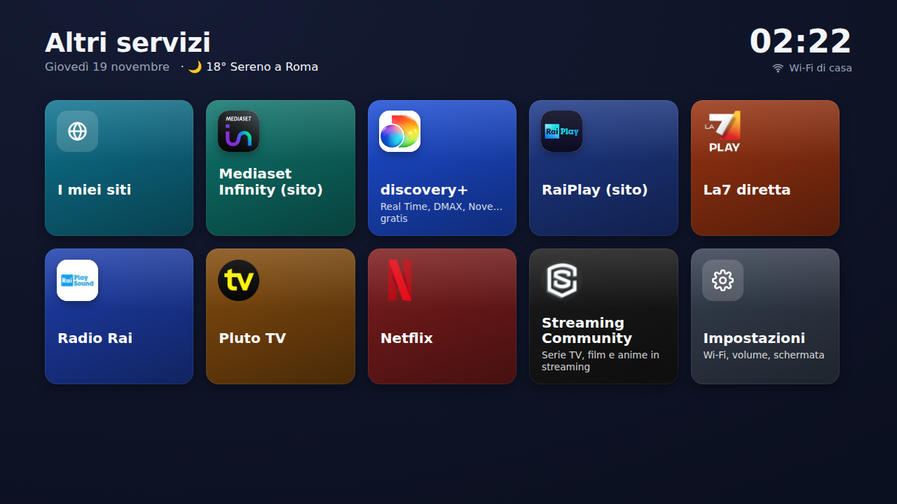

# tvbox

**Una Smart TV fatta in casa con un Mac mini del 2007.**
Debian 13, Google Chrome in modalità kiosk e un piccolo demone Python trasformano un vecchio
Mac mini in un box TV comandato dall'Apple Remote: canali in diretta Rai, Mediaset e
Warner Bros. Discovery, YouTube, RaiPlay, i tuoi siti preferiti, meteo e salvaschermo.


---

## Cosa fa

- **Canali in diretta** (Rai 1, 2, 3, Rete 4, Canale 5, Italia 1, Real Time, DMAX, Nove), ognuno
  con il programma in onda, la barra di avanzamento, la descrizione e l'immagine del programma.
- **Pannello cambio canale sopra il video**: premi MENU durante una diretta, scegli un altro
  canale senza tornare alla home; `+` e `−` del telecomando regolano il volume.
- **App RaiPlay per TV** (la versione HbbTV ufficiale) dentro Chrome, con telecomando e dirette.
- **YouTube per TV**, Mediaset Infinity, discovery+, La7, Pluto TV, Radio Rai.
- **I miei siti**: aggiungi qualunque sito con la tastiera a schermo; navigazione "assistita"
  con le frecce (un riquadro giallo salta tra le cose cliccabili), vista telefono,
  blocco di pubblicità, popup e banner dei cookie.
- **Impostazioni dalla TV**: Wi-Fi (ricerca reti e password), volume, città del meteo,
  risoluzione dello schermo con prova di 15 secondi, salvaschermo, riquadri della home.
- **Salvaschermo** con le immagini dei programmi in onda, orologio e meteo.
- **Sempre acceso**: si riaccende da solo dopo un blackout e si riavvia da solo se si blocca.

| | |
|---|---|
|  |  |
| *Pannello cambio canale sopra Rai 1* | *Salvaschermo* |
|  |  |
| *Altri servizi* | *Impostazioni* |

## Hardware

| | |
|---|---|
| Computer | Apple Mac mini Mid 2007 (`Macmini2,1`), Core 2 Duo, 2 GB RAM |
| Grafica | Intel GMA 950: niente accelerazione per Chrome, tutto in software |
| Telecomando | Apple Remote bianco (infrarossi) o in alluminio |
| Schermo | TV o monitor in VGA, DVI o HDMI (con adattatore mini-DVI) |
| Rete | cavo o Wi-Fi integrato |

Su hardware più recente funziona meglio: il limite del Mac mini è la fluidità dei video
(vedi [Limiti noti](#limiti-noti)).

## Come funziona

```
Apple Remote ──► tvd.py ──(DevTools Protocol)──► Google Chrome (kiosk)
                   │                                 │
                   ├─ API HTTP 127.0.0.1:8765 ◄──────┤ launcher/index.html (home)
                   ├─ xrandr, ALSA, wpa_cli          ├─ panel.js  (pannello sopra le dirette)
                   └─ palinsesti, meteo, loghi        ├─ nav.js    (navigazione assistita)
                                                      ├─ osk.js    (tastiera a schermo)
                                                      ├─ shield.js (pubblicità e cookie)
                                                      └─ hbbtv.js  (app TV HbbTV in Chrome)
```

- **`tvd.py`** legge il telecomando (evdev), apre i servizi, "traveste" Chrome da TV quando
  serve (RaiPlay per TV, YouTube TV), inietta gli script nelle pagine, controlla Chrome e lo
  riavvia se si blocca, cambia risoluzione, gestisce Wi-Fi e volume e serve il launcher.
- **Il launcher** è una pagina web locale pensata per il telecomando: niente mouse, tutto a
  frecce, misure in proporzione allo schermo.
- **Palinsesti**: `onAir.json` di RaiPlay, il servizio now/next di Mediaset e la guida TV di
  Warner Bros. Discovery. **Meteo**: Open-Meteo. Nessuna chiave o registrazione.
- **Sistema**: Xorg senza root, autologin sull'utente `tv`, `systemd-networkd` +
  `wpa_supplicant` per la rete, nessun desktop.

## Installazione

### A. Su un Debian 13 amd64 già installato

```bash
git clone <questo repository> tvbox && cd tvbox
sudo ./install.sh
sudo reboot
```

`install.sh` installa i pacchetti (Xorg, Chrome, Python evdev…), crea l'utente `tv`, copia
tvd e il launcher in `/opt/tvbox` e la configurazione in `/etc/tvbox`, e imposta autologin,
Wi-Fi, permessi e riavvio automatico.

### B. Preparando il disco del Mac mini da un altro PC Linux

Il firmware EFI a 32 bit del Mac mini 2007 non va d'accordo con l'installer di Debian 13.
`prepare-disk.sh` installa tutto direttamente sul disco collegato via USB, **senza toccare
il PC su cui gira** (debootstrap scaricato in una cartella temporanea):

```bash
sudo ./prepare-disk.sh /dev/sdX     # chiede conferma scrivendo CANCELLA
```

Crea MBR + ext4, Debian 13 minimale con GRUB in modalità BIOS, l'utente `admin` e lancia
`install.sh` nel chroot. I dettagli sono in [HANDOFF-CLAUDE-CODE.md](HANDOFF-CLAUDE-CODE.md).

## Telecomando

| Tasto | Nei menu | Durante un video | Durante una diretta |
|---|---|---|---|
| Frecce | muoversi | ◄ ► indietro/avanti, + − volume | + − volume |
| Centrale / OK | apri | pausa | pausa |
| MENU | indietro | indietro | **pannello cambio canale** |
| MENU tenuto premuto | home | home | home |
| Centrale tenuto premuto | puntatore (per i siti difficili) | | |

Nel pannello cambio canale: ◄ ► per scegliere (la fila gira in cerchio), OK per cambiare
canale, + − per il volume, MENU per chiudere.

## Configurazione

| File | Cosa contiene |
|---|---|
| `/etc/tvbox/config.json` | servizi, canali, sezioni della home, tempi del telecomando |
| `/etc/tvbox/session.env` | variabili della sessione X |
| `/etc/X11/xorg.conf.d/20-tvbox-video.conf` | driver video e risoluzioni per la TV |
| `~tv/.config/tvbox/` | scelte fatte dalla TV: siti, meteo, schermo, riquadri nascosti |
| `/home/tv/.tvbox.log` | registro di tvd |

Per aggiungere un canale basta una voce in `services` e il suo id in `sections` di
`config.json`; con `"onair"` compare anche il programma in onda.

## Limiti noti

- **Fluidità**: senza accelerazione grafica il Mac mini mostra circa 20–25 fotogrammi al
  secondo. Le dirette Rai (25 fps) vanno bene; Mediaset trasmette a 50 fps e scatta di più.
  Per questo durante i video lo schermo può passare da solo a 1280×720.
- **TV in VGA senza EDID**: alcune TV non comunicano le risoluzioni accettate. La
  configurazione inclusa usa 1280×720, il formato HD da TV, nitido e a tutto schermo.
- **Riavvio del Mac mini 2,1**: ignora il riavvio ACPI di Linux. tvbox usa il metodo PCI
  (`system/tvbox-reboot.conf`), necessario anche per il riavvio automatico dopo un blocco.
- **DRM**: i contenuti protetti usano Widevine di Chrome, come sul computer. Alcuni servizi
  richiedono un account (discovery+, Netflix).

## Struttura del progetto

```
tvd.py                demone principale (telecomando, Chrome, API, Wi-Fi, palinsesti)
config.json           servizi e canali
launcher/             home e script iniettati nelle pagine (+ hls.js in vendor/)
system/               file di sistema: X, autologin, rete, udev, watchdog, sudoers
install.sh            installazione su Debian 13
prepare-disk.sh       installazione del disco del Mac mini da un altro PC
diagnostica-setup.sh  diagnostica dei blocchi (netconsole, temperature)
wifi-setup.sh         Wi-Fi da riga di comando
prova-*.sh            script di prova usati durante lo sviluppo
docs/screenshots/     le immagini di questo file
```

## Nota

Progetto personale e non ufficiale, senza legami con Rai, Mediaset, Warner Bros. Discovery,
Google o Apple. tvbox apre i siti e le app web ufficiali dei servizi, come farebbe un browser
o una Smart TV; marchi, loghi e contenuti appartengono ai rispettivi proprietari.
