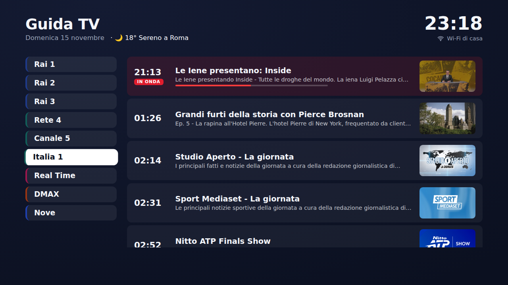
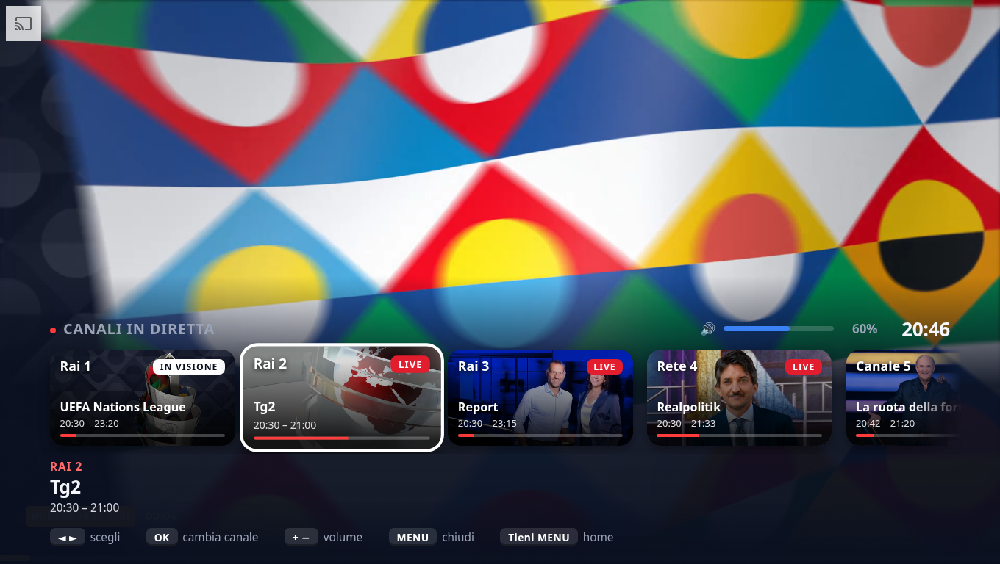
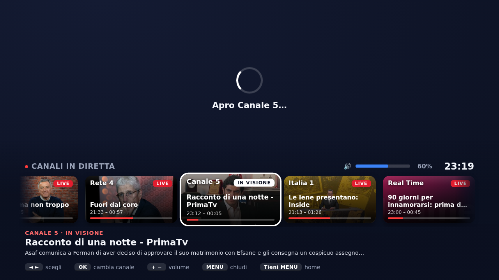
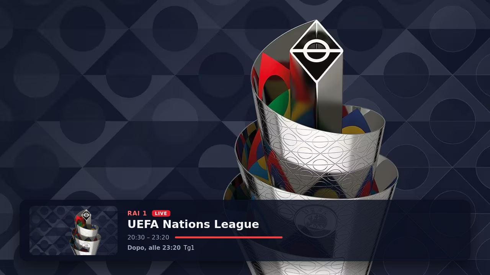
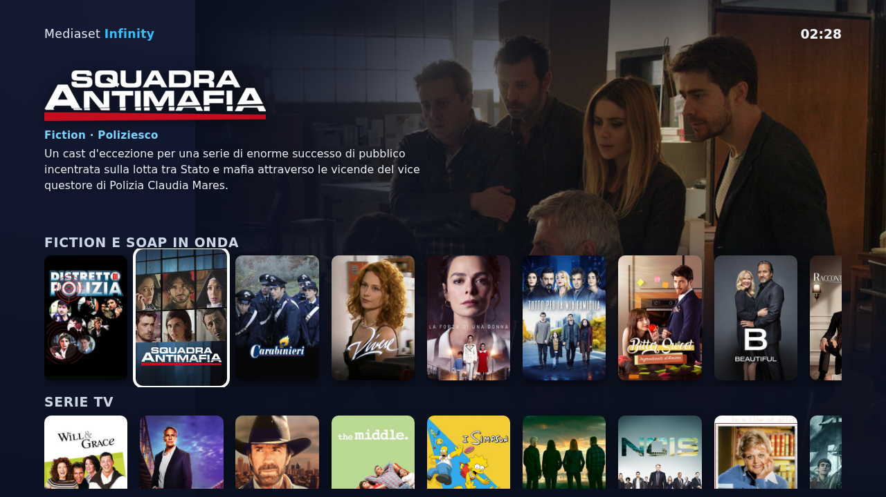
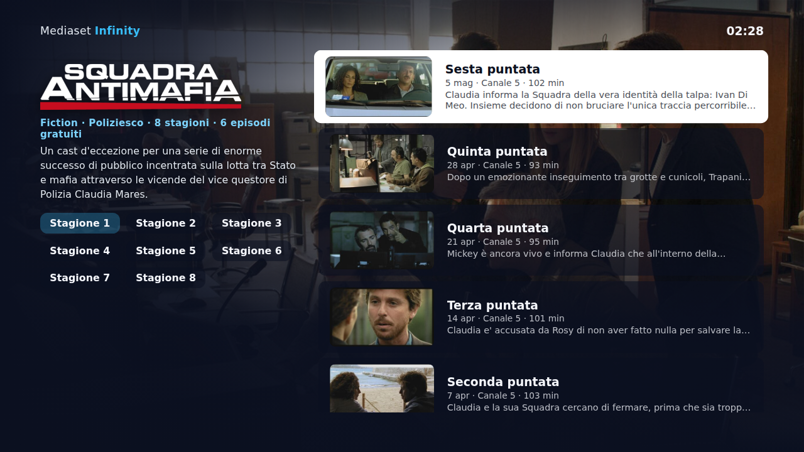
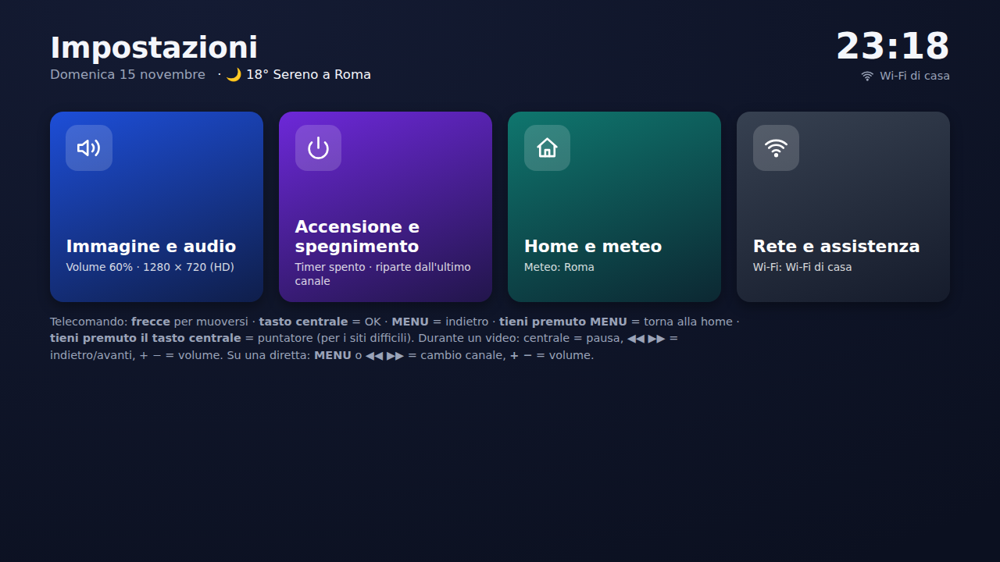
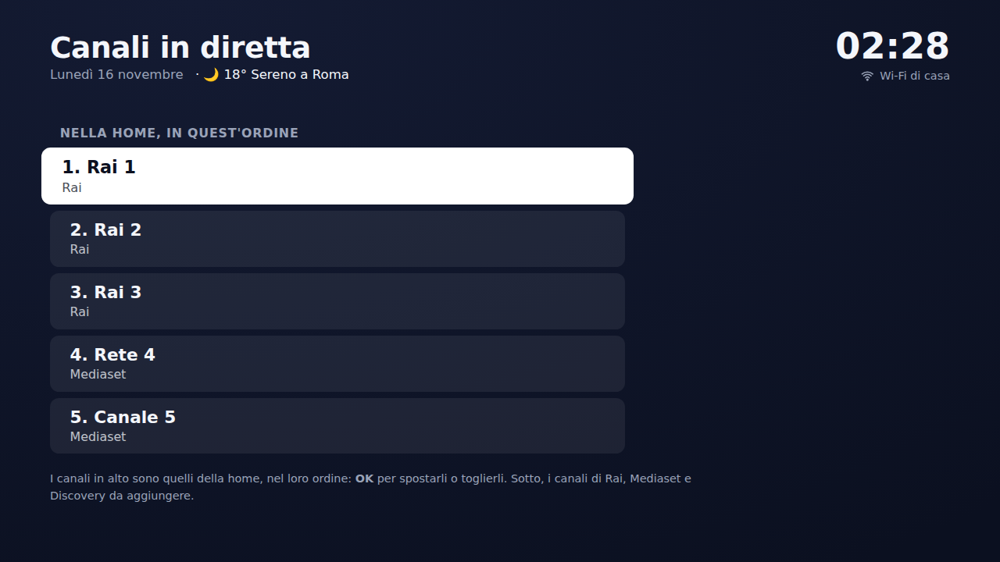

# tvbox

**Una Smart TV fatta in casa con un Mac mini del 2007.**
Debian 13, Google Chrome in modalità kiosk e un demone Python trasformano un vecchio Mac mini
in un box TV comandato dall'Apple Remote: 39 canali in diretta Rai, Mediaset e Discovery con
guida TV, fiction, serie, programmi e cartoni di Mediaset Infinity, YouTube, RaiPlay, i tuoi siti, meteo e salvaschermo.


---

## Cosa fa

- **Canali in diretta**: un catalogo di 39 canali (Rai, Mediaset, Discovery); scegli dalla TV quali
  mettere nella home e in che ordine. Ognuno con programma in onda, avanzamento, descrizione e immagine.
- **Mediaset Infinity per la TV**: fiction, serie, programmi TV, cartoni, documentari e approfondimento in righe di locandine, pagina della serie con
  stagioni ed episodi, "Continua a guardare"; l'episodio parte a tutto schermo e, se lo avevi
  lasciato a metà, riparte da lì.
- **StreamingCommunity**: un secondo catalogo con schede HOME / SERIE TV / FILM, ricerca,
  "Continua a guardare" e righe per genere con i titoli più visti, con la stessa pagina della serie.
- **AnimeUnity**: un catalogo di anime con schede HOME / ANIME, ricerca e "Continua a guardare".
  In entrambi l'episodio parte da solo a tutto schermo e riprende da dove l'avevi lasciato.
- **Accesso agli account dentro la TV**: Mediaset e StreamingCommunity chiedono l'accesso con
  una schermata di tvbox (email/utente e password con la tastiera a schermo); l'accesso lo fa la
  TV senza mostrare il sito e la password non viene salvata. Si esce dalle Impostazioni.
- **Dirette che si riparano da sole**: se il video resta fermo la TV riapre il canale, e se il sito
  chiede di accedere lo mostra invece dello schermo nero.
- **Guida TV**: i programmi delle prossime ore per ogni canale; OK sul programma in onda lo apre.
- **Pannello cambio canale sopra il video**: MENU (o ◄ ►) durante una diretta; il pannello
  resta a schermo mentre il canale nuovo si carica, con un sipario scuro e il cerchio di
  caricamento. Dentro anche volume, Guida TV, timer e impostazioni.
- **Banner del programma** quando parte un canale: titolo, orario e cosa c'è dopo.
- **App RaiPlay per TV** (la versione HbbTV ufficiale) dentro Chrome, con telecomando e dirette.
- **YouTube per TV**, Mediaset Infinity, discovery+, La7, Pluto TV, Radio Rai.
- **I miei siti**: qualunque sito con la tastiera a schermo; navigazione "assistita" con le
  frecce (un riquadro giallo salta tra le cose cliccabili), vista telefono, blocco di
  pubblicità, popup e banner dei cookie.
- **Impostazioni dalla TV**, in quattro gruppi: immagine e audio (volume, risoluzione con
  prova di 15 secondi), accensione e spegnimento (ultimo canale all'accensione, timer,
  salvaschermo), home e meteo, rete e assistenza (Wi-Fi con ricerca e password, account).
- **Salvaschermo** con le foto dei programmi in onda; dopo un'ora lo schermo si spegne.
- **Sempre acceso**: si riaccende dopo un blackout, si riavvia da solo se si blocca, riparte
  dall'ultimo canale guardato.

| | |
|---|---|
|  |  |
| *Guida TV* | *Pannello cambio canale sopra una diretta* |
|  |  |
| *Mentre il canale nuovo si carica* | *Banner all'apertura di un canale* |
|  |  |
| *Mediaset Infinity: il catalogo* | *Stagioni ed episodi di una serie* |
|  |  |
| *Impostazioni* | *Scelta e ordine dei canali* |
|  | |
| *Salvaschermo* | |

## Hardware

| | |
|---|---|
| Computer | Apple Mac mini Mid 2007 (`Macmini2,1`), Core 2 Duo, 2 GB RAM |
| Grafica | Intel GMA 950: niente accelerazione per Chrome, tutto in software |
| Telecomando | Apple Remote bianco (infrarossi) o in alluminio |
| Schermo | TV o monitor in VGA, DVI o HDMI (con adattatore mini-DVI) |
| Rete | cavo o Wi-Fi integrato |

Su hardware più recente funziona meglio: il limite del Mac mini è la fluidità dei video
(vedi [Limiti noti](#limiti-noti)).

## Come funziona

```
Apple Remote ──► tvd (tvbox/) ──(DevTools Protocol)──► Google Chrome (kiosk)
                   │                                      │
                   ├─ API HTTP 127.0.0.1:8765 ◄───────────┤ launcher/ (home, Guida TV, Impostazioni)
                   ├─ xrandr, ALSA, wpa_cli               └─ launcher/inject/ (nelle pagine dei servizi)
                   └─ palinsesti, meteo, loghi                 pannello, banner, navigazione assistita,
                                                                tastiera, pubblicità, app HbbTV
```

- **tvd** legge il telecomando, capisce in che **stato** è la TV (home, diretta, pannello,
  app TV, video, sito…) e usa una **tabella dei tasti** per decidere cosa fare
  ([tvbox/keys.py](tvbox/keys.py)). Apre i servizi, "traveste" Chrome da TV quando serve
  (RaiPlay, YouTube TV), inietta gli script nelle pagine, sorveglia Chrome e lo riavvia se si
  blocca, cambia risoluzione, gestisce Wi-Fi, volume e timer, e serve il launcher.
- **Il launcher** è una pagina web locale pensata per il telecomando: niente mouse, tutto a
  frecce, misure in proporzione allo schermo. Le schede dei canali sono le stesse nella home
  e nel pannello sopra le dirette ([launcher/js/cards.js](launcher/js/cards.js)).
- **Palinsesti**: RaiPlay, Mediaset e Warner Bros. Discovery (in onda e prossime ore).
  **Meteo**: Open-Meteo. Nessuna chiave o registrazione.
- **Sistema**: Xorg senza root, autologin sull'utente `tv`, `systemd-networkd` +
  `wpa_supplicant` per la rete, nessun desktop.

## Installazione

### A. Su un Debian 13 amd64 già installato

```bash
git clone https://github.com/Nefer97/TV-Box.git tvbox && cd tvbox
sudo ./install.sh
sudo reboot
```

`install.sh` installa i pacchetti (Xorg, Chrome, Python evdev…), crea l'utente `tv`, copia
tvd e il launcher in `/opt/tvbox` e la configurazione in `/etc/tvbox`, e imposta autologin,
Wi-Fi, permessi e riavvio automatico.

### B. Preparando il disco del Mac mini da un altro PC Linux

Il firmware EFI a 32 bit del Mac mini 2007 non va d'accordo con l'installer di Debian 13.
`prepare-disk.sh` installa tutto direttamente sul disco collegato via USB, **senza toccare
il PC su cui gira** (debootstrap scaricato in una cartella temporanea):

```bash
sudo ./prepare-disk.sh /dev/sdX     # chiede conferma scrivendo CANCELLA
```

Crea MBR + ext4, Debian 13 minimale con GRUB in modalità BIOS, l'utente `admin` e lancia
`install.sh` nel chroot. I dettagli sono in [HANDOFF-CLAUDE-CODE.md](HANDOFF-CLAUDE-CODE.md).

### Aggiornare

Dal PC con la cartella del progetto, con il Mac mini acceso in rete:

```bash
./deploy.sh                 # prove, verifica degli indirizzi, copia, installazione (chiede la password di admin)
./deploy.sh --rollback      # torna alla versione installata prima
TV_HOST=192.168.1.x ./deploy.sh       # se tv.local non risponde
```

## Telecomando

| Tasto | Nei menu | Durante un video | Durante una diretta | Nel pannello |
|---|---|---|---|---|
| ▲ ▼ (+ −) | muoversi | volume | volume | volume |
| ◄ ► | muoversi | indietro / avanti | pannello sul canale vicino | scegliere (in cerchio) |
| Centrale / OK | apri | pausa | pausa | cambia canale |
| MENU | indietro | indietro | **pannello cambio canale** | chiudi |
| MENU tenuto premuto | home (dalla home: **Impostazioni**) | home | home | home |
| Centrale tenuto premuto | puntatore (per i siti difficili) | | | |

Nei siti: **PLAY** mette in pausa il video della pagina (anche un video incorporato, per esempio
YouTube, se lo si è avviato con un clic); se non c'è un video apre la **barra del volume** (▲ ▼ per regolare, qualunque altro tasto chiude, si chiude da sola dopo 4 s).
Il riquadro giallo sa scegliere anche i **player incorporati** (YouTube, Vimeo, emittenti…: iframe
che ammettono il tutto schermo o comunque grandi), anche con una copertura trasparente sopra: OK
ci clicca al centro (se c'è una copertura, il primo OK la toglie e il secondo avvia il video). Se un sito va **a tutto schermo con un player suo** che tvd non riconosce
(per esempio dentro un iframe), oppure se si è cliccato in un player incorporato **grande quasi
quanto lo schermo**, i tasti vanno al player come da tastiera: ◄ ► frecce (avanti / indietro), OK e PLAY
barra spaziatrice (pausa); ▲ ▼ restano il volume della TV, MENU indietro.

## Configurazione

| File | Cosa contiene |
|---|---|
| `/etc/tvbox/config.json` | servizi, sezioni della home, identità, tempi del telecomando |
| `~tv/.config/tvbox/prefs.json` | scelte fatte dalla TV: canali, siti, meteo, schermo, riquadri nascosti, accensione |
| `/etc/X11/xorg.conf.d/20-tvbox-video.conf` | driver video e risoluzioni per la TV |
| `/var/log/tvbox/tvd.log` | registro di tvd (leggibile anche da `admin`) |

I canali in diretta vengono dal catalogo in [tvbox/channels.py](tvbox/channels.py) (indirizzi e
palinsesti di Rai, Mediaset e Discovery); quali compaiono e in che ordine si sceglie dalla TV
(Impostazioni → Home e meteo → Canali in diretta).

Ogni servizio in `config.json` ha un **tipo** che decide come si comporta col telecomando:
`hbbtv` (app per TV come RaiPlay), `tvapp` (YouTube TV), `web` (siti normali) o `page`
(pagine del launcher):

```json
"la7": { "kind": "web", "label": "La7 diretta", "icon": "tv", "color": "#9a3412",
         "auto_fullscreen": true, "url": "https://www.la7.it/dirette-tv" }
```

Requisiti e architettura (come è fatta tvbox e perché) sono in [docs/](docs/).

## Sviluppo

```bash
python3 -m unittest discover -s tests -v     # prove automatiche (senza Chrome né telecomando)
bash tools/uitest.sh                         # grafica e dialogo tvd ↔ Chrome in Chromium sul PC
python3 tools/checklinks.py                  # gli indirizzi di Rai, Mediaset e Discovery funzionano ancora?
```

Le prove automatiche coprono la logica del telecomando (doppioni, ripetizioni, pressioni lunghe),
la tabella dei tasti, la configurazione, le preferenze, i palinsesti, il catalogo Mediaset,
l'accesso agli account, le regole di "cosa si sta guardando" e la sorveglianza delle dirette. Le prove della grafica aprono
home, Guida TV, Impostazioni, canali e Mediaset come col telecomando e controllano contenuti,
misure ed errori JavaScript. Poi la vera classe TV guida Chromium con tre canali finti (pagine
locali con un video disegnato al momento): sipario, schermo intero, banner, volume, pannello,
cambio canale, pausa, diretta ferma riaperta, episodio e ritorno alla serie.
`deploy.sh` esegue tutto prima di ogni installazione; gli indirizzi esterni danno solo un avviso.

`tools/vmtest.sh` prova un'installazione da zero in una macchina virtuale (Debian 13 ufficiale):
è lenta e scalda il PC, quindi di serie usa un solo processore a priorità bassa.

## Limiti noti

- **Fluidità**: senza accelerazione grafica il Mac mini mostra circa 20–25 fotogrammi al
  secondo. Le dirette Rai (25 fps) vanno bene; Mediaset trasmette a 50 fps e scatta di più.
  Per questo durante i video lo schermo può passare da solo a 1280×720.
- **TV in VGA senza EDID**: alcune TV non comunicano le risoluzioni accettate. La
  configurazione inclusa usa 1280×720, il formato HD da TV, nitido e a tutto schermo.
- **Riavvio del Mac mini 2,1**: ignora il riavvio ACPI di Linux. tvbox usa il metodo PCI
  (`system/tvbox-reboot.conf`), necessario anche per il riavvio automatico dopo un blocco.
- **DRM**: i contenuti protetti usano Widevine di Chrome, come sul computer. Alcuni servizi
  richiedono un account (discovery+, Netflix).

## Struttura del progetto

```
tvd.py                avvio di tvd
tvbox/                il demone, un modulo per compito (vedi tvbox/__init__.py):
                        visione, strato TV, canali, cataloghi (mediaset.py, sc.py) e
                        accesso, timer, sorveglianza…
config.json           servizi e canali
launcher/             la home: index.html, css/, js/ (+ hls.js in vendor/)
launcher/inject/      script iniettati nelle pagine dei servizi (strato TV, player, …)
system/               file di sistema: X, autologin, rete, udev, watchdog, sudoers
install.sh            installazione su Debian 13 (--update / --rollback per gli aggiornamenti)
deploy.sh             aggiornamento dal PC
prepare-disk.sh       installazione del disco del Mac mini da un altro PC
tests/                prove automatiche
tools/                prove della grafica e del dialogo con Chrome (uitest), indirizzi
                        esterni (checklinks), installazione in VM (vmtest), diagnostica,
                        Wi-Fi da riga di comando
docs/                 requisiti, architettura e screenshot
docs/screenshots/     le immagini di questo file
```

## Nota

Progetto personale e non ufficiale, senza legami con Rai, Mediaset, Warner Bros. Discovery,
Google o Apple. tvbox apre i siti e le app web dei servizi, come farebbe un browser o una
Smart TV; marchi, loghi e contenuti appartengono ai rispettivi proprietari.
